<!-- datasheet:banner -->
<p align="center">
  <picture>
    <source media="(prefers-color-scheme: dark)" srcset=".github/assets/banner-dark.svg">
    
  </picture>
</p>
<!-- /datasheet:banner -->

# Odysseus image tools

Two things for the local Odysseus setup (`~/Documents/Docker/Odysseus`), kept out of Odysseus's own folders and its `.venv`:

1. **Image generation** – already wired, nothing in this folder (see below).
2. **Uncensor** – an MCP server (`uncensor`) that finds mosaic / black-bar censoring in an image and fills it in with a local
   inpainting model. Also a command line tool.

<!-- datasheet:figure -->
## At a glance

<p align="center">
  <picture>
    <source media="(prefers-color-scheme: dark)" srcset=".github/assets/diagram-dark.svg">
    
  </picture>
</p>

| Characteristic | Detail |
| --- | --- |
| **Detection** | Frequency-domain lattice analysis and block-variance profiling; mosaic blocks 4–32 px at any offset, plus solid black bars |
| **Fill-in** | Manga-specialised Fast Fourier Convolution inpainting model (default `lama`); `animagine` and `sdxl` diffusion models optional |
| **Interfaces** | MCP server for Odysseus (`find_censored_regions`, `uncensor_image`, `uncensor_folder`) and `uncensor_cli.py` |
| **Safety** | Originals are never touched and nothing is overwritten; results are new files |
<!-- /datasheet:figure -->

## Uncensor

What it is: detection uses frequency-domain lattice analysis and block variance profiling. The fill-in uses a **manga-specialized Fast Fourier Convolution inpainting model** (`models/anime-manga-big-lama.pt`, fine-tuned on ~300k anime/manga illustrations) running via PyTorch MPS in under 100 ms per image with seamless linework and zero prompt hallucination. SDXL / Animagine XL diffusion inpainting is also supported as an opt-in fallback via `--model sdxl` or `--model animagine`.

### From Odysseus

Tools (the local model calls them): `find_censored_regions`, `uncensor_image`, `uncensor_folder`, `uncensor_job_status`, `unload_uncensor_model`.
Registered in Odysseus's DB as server id `uncensor` (restart Odysseus.app after changing the server). Example task for the model:

> Uncensor `/path/page_012.png`.

Results are new files in `~/Pictures/odysseus-uncensor/` (`<name>_uncensored.png`, and `<name>_regions.png` from detection). **Originals are never touched**,
and nothing is overwritten (`_2`, `_3` … is added). `$UNCENSOR_OUT_DIR` changes the folder.

### From the terminal

```sh
cd ~/Documents/Docker/odysseus-image-tools
uv run python uncensor_cli.py detect PAGE.png                       # what would be filled in; writes a preview, changes nothing
uv run python uncensor_cli.py run PAGE.png                          # inpaint with fast anime/manga LaMa model (<100ms)
uv run python uncensor_cli.py run CHAPTER_FOLDER/                   # every page in folder
uv run python uncensor_cli.py run PAGE.png --model animagine        # optional: use diffusion inpainting instead
uv run python uncensor_cli.py run PAGE.png --box 120,340,200,160    # custom rectangle x,y,w,h (skips detection)
uv run python uncensor_cli.py run PAGE.png --mask mask.png          # white = fill in
```

Options: `--model` (`lama` [default], `animagine`, `sdxl`), `--grow` (pixels to widen the mask), `--steps` (for diffusion), `--guidance`, `--strength`.

### What it finds, and what it does not

- **Mosaic**: found by its 2D Fourier block grid and edge contrast lattice (block size 4–32 px, any offset), including shaded manga and JPEGs.
- **Black bars**: solid near-black rectangles. Page-sized black fills and panel borders are ignored.

### Resources

- **Default Model**: `models/anime-manga-big-lama.pt` (196 MB TorchScript). Executes on Apple Silicon GPU (`mps`) in ~75 ms per image with zero prompt hallucination.
- **Diffusion Models** (optional fallback): `models/animagine-xl-inpainting` and `models/sdxl-inpainting` (safetensors). Loaded on demand when `--model sdxl` or `--model animagine` is specified. Auto-unloaded after 5 idle minutes.

### Files

| File | |
|---|---|
| `uncensor_server.py` | the MCP server |
| `uncensor_cli.py` | command line front end |
| `uncensor/detect.py` | mosaic and bar detection, mask and preview |
| `uncensor/inpaint.py` | the SDXL inpainting step (crops each region with context, blends back with a soft edge) |
| `uncensor/pipeline.py` | detect + fill + write; shared by both front ends |
| `setup.sh`, `download_models.py` | create `.venv` (pins `mcp<2`, matching Odysseus's server style) and fetch the weights |
| `tests/test_detect.py` | detector vs known ground truth on harmless synthetic data (11 checks) |
| `tests/test_mcp.py <mosaic.png>` | drives the server over stdio like Odysseus (find, fill, folder job, unload) |

Rebuild from scratch: `./setup.sh && .venv/bin/python download_models.py`.

## Image generation (already set up)

Odysseus's built-in `image_gen` tool needed an image endpoint and had none (it expected OpenAI's gpt-image / dall-e). Docker Model Runner already had
`docker.io/ai/stable-diffusion` pulled and serves `/v1/images/generations`, so:

- `model_endpoints` row `dmr_image` ("Local Image Model (Docker Model Runner)", `http://127.0.0.1:12434/v1`, type `image`) was added to `data/app.db`.
- `data/settings.json`: `image_model` = `docker.io/ai/stable-diffusion:latest` (was `stable-diffusion-3.5-medium`, which had no weights).
- Verified through Odysseus's own `image_gen` MCP server: 1024×1024 in ~37 s, saved to the gallery. Needs Docker Model Runner running (it is, on port 12434).
- Backups: `data/app.db.bak_imagegen_*`, `data/settings.json.bak_imagegen_*`, `data/app.db.bak_uncensor_*`. Undo = delete the `dmr_image` / `uncensor` rows and restore `image_model`.
- Not yet driven from the chat window by the Qwen model (loading it alongside the image model is heavy on memory); the tool path below it is tested.

## License

MIT. See [LICENSE](LICENSE).
